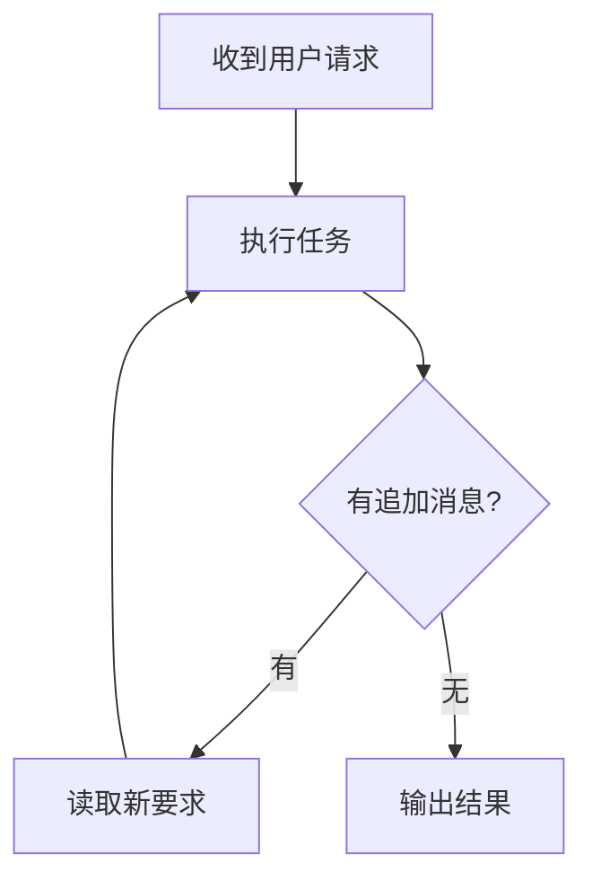

# 执行中追加消息与流程图

聊天任务运行时，输入框继续接收消息，Enter 或“追加”会发送补充要求；“停止”使用独立按钮。模型生成中的请求会被中止并结合新消息重新请求，当前工具和授权等待会继续，工具结果写回历史后再读取补充消息。多条消息按发送顺序处理，附件和文件引用照常生效，内容相同的消息通过各自 ID 确认。

追加要求并入当前请求的要求列表，保留当前运行 ID、工具历史和任务进度。最新修正优先于先前冲突要求。首条消息尚在加载记忆、附件或初始化引擎时也能登记追加消息。追加准备失败会显示原因，停止会取消尚未读取的消息。消息携带会话 ID，切换会话后仍由对应会话处理。

引擎开始最终收尾后到达的消息进入下一轮。斜杠命令和专用图片生成 Provider 继续按完整请求顺序排队。

Markdown 中的 Mermaid 围栏会显示图表，例如：

````markdown

````

每张图支持复制 Mermaid 源码、通过 VS Code 保存对话框下载 PNG、放大预览和缩放。图中文字使用蓝色，预览与导出的 PNG 保持一致。流式输出期间显示生成提示，围栏闭合后直接绘图，不展示源码或“查看源码”入口；后续正文更新保留图表和预览状态。语法错误时显示原因，仍可通过“复制为代码”获取内容。

Mermaid 按需加载，使用 strict 模式，关闭 HTML 标签。PNG 在 Webview 中转换，沿用已有 `image.save` 协议，不依赖外部服务。Vite 使用相对资源路径，宿主以 ES module 加载入口，支持扩展资源目录中的动态导入。测试资源不会进入扩展安装包。

验证命令：

```powershell
npm run compile
npm run test:unit
npm --prefix webview test
npm --prefix webview run build
npm --prefix webview run test:browser
```

浏览器回归测试需要 Node.js 22 和本机 Chrome/Edge/Chromium；可通过 `BROWSER_PATH` 指定浏览器路径。它使用生产构建和与宿主相似的资源路径、CSP，验证真实 Vue 组件的流式渲染、复制、PNG 转换、预览、多图和错误回退。保存对话框由宿主已有处理器负责，浏览器测试验证向其发送的 PNG 数据。
